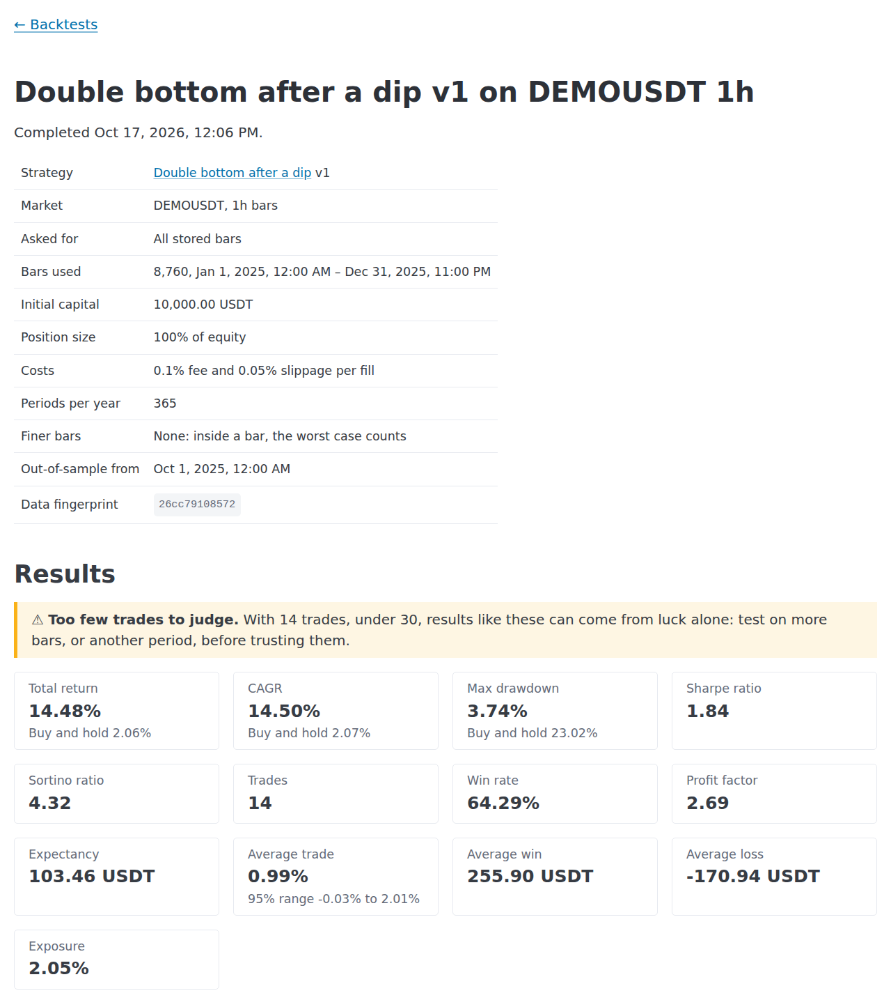
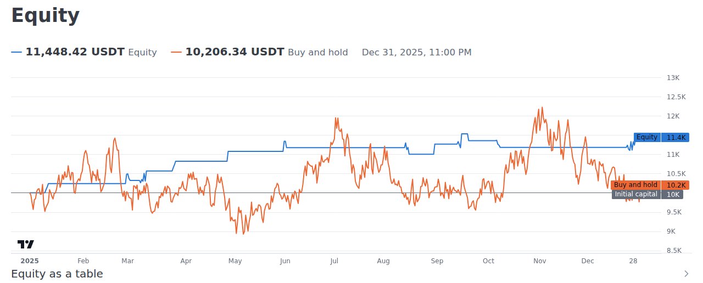

# Trading Platform

A self-hosted app to test trading ideas on real prices, and keep an honest record of the
trades you make.

Import price files, write a strategy as rules, and see whether it would have made money after
costs, next to simply buying and holding. Then log your trades, write about them in a journal,
and check whether your live trading matches the backtest. It runs on your own computer, for
one person. It gives no financial advice and places no orders.

## Why

A chart makes every idea look good, because you remember the times it worked. This app counts
every signal a rule gives, the losers included, and pays the fees and slippage you would
really pay. [Why this exists](docs/why.md) tells the story behind it.

## What it looks like





## What you can do

- **Import prices:** Binance's monthly files, Yahoo Finance and TradingView exports, or any
  CSV of open, high, low and close, in bars from 1 minute to 1 day. Bad rows are reported by
  line, and bigger bars are built from smaller ones.
- **Write strategies** in a small rule language: indicators, patterns such as equal lows,
  orders at a price, stops at levels, trailing stops, trading sessions and other day-trading
  blocks. Every change makes a new version.
- **Backtest honestly:**
  - Orders fill at the next bar's open or at their price, with fees and slippage.
  - When a bar can't say what came first, the worst case counts, unless 1-minute bars settle
    it.
  - Each run shows buy and hold beside it, can hold out the latest months, and warns when
    there are too few trades to judge.
- **Record trades:** P&L net of both fees, corrections that need a reason, and a history the
  database won't let anyone rewrite.
- **Keep a journal:** plans, reviews and notes, with emotions and tags. Published entries keep
  every version.
- **Analyse:** results by strategy, symbol, emotion or tag; realized P&L per currency, never
  converted; and live trading beside its backtest.
- **Automate:** a REST API with interactive docs, and a command line for big imports.

## Quick start

You need [Docker](https://docs.docker.com/get-docker/) with Compose, `make`,
[uv](https://docs.astral.sh/uv/) and [Node.js](https://nodejs.org/) 22.

```sh
git clone https://github.com/pedroapap/trading-platform.git
cd trading-platform
make setup   # installs the packages and writes .env with a random secret
make dev     # starts the database, the API on :8000 and the app on :5173
```

When the logs say *Application startup complete*, create your account in a second terminal:

```sh
make user email=you@example.com
```

Then open <http://localhost:5173> and log in. [Getting started](docs/getting-started.md)
continues with a 15-minute tour using the sample prices that come with the app.

## Documentation

| Page | What it answers |
|---|---|
| [Getting started](docs/getting-started.md) | How to install it, then a guided tour with the sample data |
| [Why this exists](docs/why.md) | The story behind it, its principles, and what it isn't |
| [Use cases](docs/use-cases.md) | 75 short recipes, from logging a trade to backing up |
| [Stories](docs/stories.md) | Six longer walk-throughs, including a test on Bitcoin's real history |
| [User guide](docs/guide.md) | Every page and field, how fills are simulated, and what each number means |
| [The rule language](docs/rules.md) | Writing strategies, with a cookbook of 12 |
| [Automating](docs/api.md) | The REST API and the command line, with curl and Python examples |
| [The data model](docs/schema.md) | The database's tables, checked against the migrations |
| [Roadmap](docs/roadmap.md) | Current limits and what could come next |
| [Sample data](docs/sample-data/README.md) | The made-up prices used in the docs, and how they are made |

## Development

- **Backend** (`backend/`): Python 3.12, FastAPI, SQLAlchemy, Alembic and pandas, on
  PostgreSQL 16 with TimescaleDB.
- **Frontend** (`frontend/`): React, TypeScript and Vite. Its API types are generated from the
  API's schema.

| Command | What it does |
|---|---|
| `make setup` | Installs both sides' packages and writes `.env` |
| `make dev` | Runs the database, the API and the app with auto-reload |
| `make test` | Runs the backend tests against a throwaway database, then the frontend tests |
| `make lint` | Lints, checks formatting and typechecks both sides |
| `make fmt` | Fixes lint issues and formats |
| `make openapi` | Snapshots the API's schema and regenerates the frontend's types |
| `make migrate` | Applies database migrations |
| `make revision m="…"` | Writes a new migration from the models |
| `make db-shell` | Opens `psql` on the database |
| `make backup`, `make restore file=…` | Saves the database, or replaces it with a backup |

Run `make help` for every target. On each push, GitHub Actions runs the same checks:
- **Backend:** ruff, a check that the migrations match the models, and the tests against a
  TimescaleDB service.
- **Frontend:** the linter, formatting, the typecheck, a check that the API types match the
  schema, the tests and the build.

The docs are checked by the backend tests too. Their links must resolve, their example
strategies must be valid, the endpoints they name must exist, and the data model page must
match the database the migrations build.
