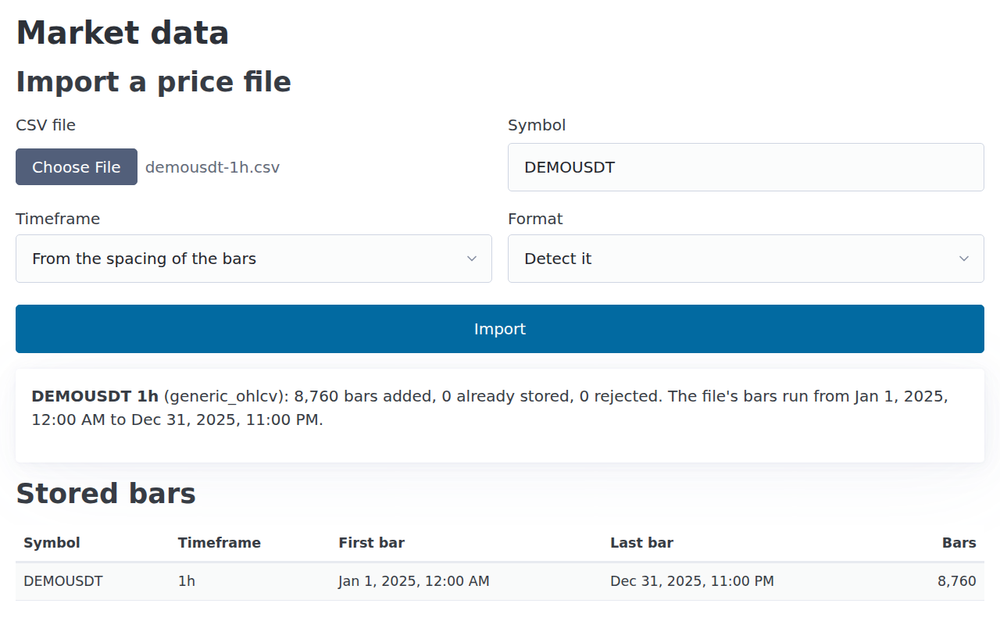
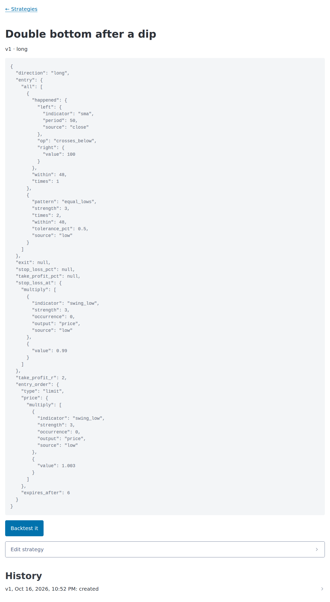
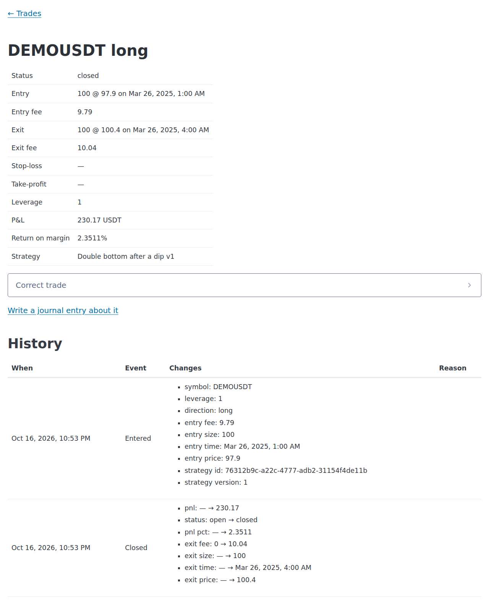
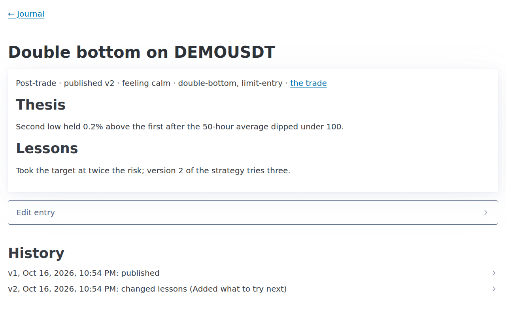
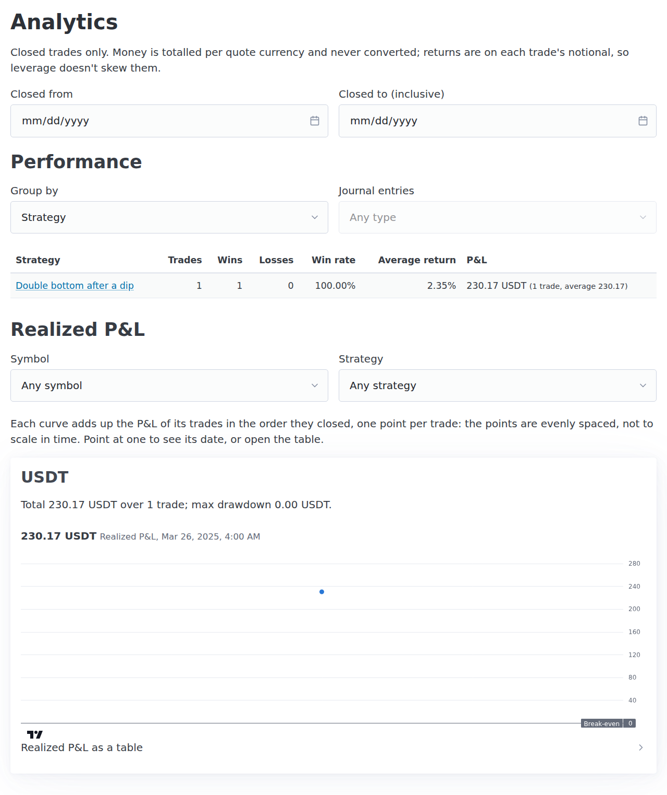

# Getting started

This page installs the app, creates your account, and then takes you on a 15-minute tour with
the sample prices that come with it. By the end you will have backtested a strategy, changed
it, recorded a trade, written about it in the journal, and seen it in the analytics.

## What you need

- [Docker](https://docs.docker.com/get-docker/) with Compose, to run the database, the API
  and the app.
- `make`.
- [uv](https://docs.astral.sh/uv/), which installs Python 3.12 and the backend's packages.
- [Node.js](https://nodejs.org/) 22 with npm, for the app's packages.

## Install and start it

```sh
git clone https://github.com/pedroapap/trading-platform.git
cd trading-platform
make setup   # installs the packages and writes .env with a random secret
make dev     # starts the database, the API on :8000 and the app on :5173
```

`make dev` keeps running and shows the logs. The first start builds the containers, which
takes a few minutes, then sets up the database. Wait until the logs say *Application startup
complete*, leave it running, and open a second terminal for the next step.

## Create your account

```sh
make user email=you@example.com
```

It asks for a password twice: 12 to 128 characters. The app is for one person, so this is
the account you will use from now on.

## Log in

Open <http://localhost:5173> and log in with that email and password.

## A tour with the sample data

The sample prices are a year of **made-up** hourly bars for a made-up symbol, DEMOUSDT.
Double bottoms are planted in them on purpose, so the first strategy has something to find.
[Their README](sample-data/README.md) explains how they are made.

The app shows times in your browser's time zone. The times below are in UTC, so yours may be
shifted by a few hours.

### 1. Import the prices

Go to **Market data**. Choose the file `docs/sample-data/demousdt-1h.csv`, type the symbol
`DEMOUSDT`, and leave the timeframe and format for the app to work out. Then select
**Import**.

The summary says: *DEMOUSDT 1h (generic_ohlcv): 8,760 bars added, 0 already stored, 0
rejected.* The stored bars now run from 1 January 2025 to 31 December 2025.



### 2. Check its currency

Go to **Instruments**. DEMOUSDT is in USDT, guessed from its name. Money for DEMOUSDT will be
totalled in USDT, apart from any other currency.

### 3. Create a strategy from an example

Go to **Strategies** and select **New strategy**. Name it `Double bottom after a dip`. Open
**Start from an example** and choose **Double bottom after a dip**, then select **Create
strategy**.

In words, the rule says:

- **Wait for a dip and two equal lows.** The 50-bar average has crossed below 100 within the
  last 48 bars. Since then, price has made two swing lows within 0.5% of each other.
- **Enter at a limit price.** Buy 0.3% above the latest low, with an order that works for 6
  bars.
- **Exit at a stop or a target.** The stop-loss is 1% under that low. The take-profit is
  twice the risk, which is the distance from the entry to the stop.



### 4. Backtest it

Select **Backtest it**. Fill in:

- **Symbol:** `DEMOUSDT`. The timeframe is already set to 1h.
- **Out-of-sample from:** 1 October 2025, 00:00. This holds the last quarter out, to see
  whether the rule still works on bars it wasn't shaped on.
- **Fee %:** `0.1`. **Slippage %:** `0.05`.

Leave the capital at 10,000, the position at 100% of equity and periods per year at 365, then
select **Run backtest**. It finishes in a second or two.


What it found:

- **14 trades**, 9 of them winners (64.29%), for a **total return of 14.48%**. Buying and
  holding the same bars made 2.06%.
- **Small drawdown.** The deepest fall from a peak was 3.74%, against 23.02% for buy and
  hold.
- **Average trade:** 0.99%, but its 95% range runs from −0.03% to 2.01%.
- **A warning:** 14 trades are under 30, *too few to judge*. Results like these can come from
  luck alone.
- **Out-of-sample** (October to December): +0.81% from 2 trades, while buy and hold lost 1.60%.


The rule wins here because the double bottoms were planted for it. On real prices, it would
have to prove itself.

### 5. Change it, and compare

Open the strategy again and select **Edit strategy**. In the definition, change
`"take_profit_r": 2` to `"take_profit_r": 3`, for a target three times the risk. Then select
**Save changes**.

The history now lists version 2, *changed take_profit_r*. Version 1 and its backtest are kept
as they were.

Backtest version 2 with the same settings: **12 trades, a 13.16% return**, and +2.08%
out-of-sample. The **Backtests** page lists both runs, so you can compare them.

### 6. Record a trade

Say you took the 26 March signal yourself. Go to **Trades** and select **New trade**, then
fill in:

- **Symbol:** `DEMOUSDT`. The direction stays long.
- **Entry price:** `97.90`. **Size:** `100`. **Entry fee:** `9.79`.
- **Entry time:** 26 March 2025, 01:00.
- **Strategy:** *Double bottom after a dip (v2)*, with **Strategy version** `1`, the version
  whose signal you followed.

Select **Log trade**. On the trade's page, open **Close trade** and enter an exit price of
`100.40` at 04:00 the same day, with an exit fee of `10.04`. Then select **Save exit**.

The trade is closed with a **P&L of 230.17 USDT**, net of both fees: 2.35% on the money put
in. Its history lists each event and what it changed.



### 7. Write about it in the journal

On the trade's page, select **Write a journal entry about it**. The entry is already a
post-trade review of this trade. Fill it in:

- **Emotion:** calm.
- **Title**, **Thesis** and **Lessons**: in your own words.
- **Tags:** `double-bottom, limit-entry`. A tag is one word: letters, digits, `-` and `_`.

Select **Save draft**, then **Publish**. A published entry can still be edited, but each edit
needs a reason and makes a new version. Try it: change the lessons, give a reason, and select
**Save as version 2**. The history keeps both versions.



### 8. Compare the backtest with your trading

Open version 1's backtest again from **Backtests**. Under **Backtest and live**, your trade now
sits beside the backtest's:

| | Backtest | Live |
|---|---|---|
| Trades | 14 | 1 |
| Win rate | 64.29% | 100% |
| Average return | 0.99% | 2.35% |
| Total P&L | 1,448.42 USDT | 230.17 USDT |

### 9. See the analytics

Go to **Analytics**. Grouped by strategy, *Double bottom after a dip* has 1 trade and 1 win,
with an average return of 2.35% and 230.17 USDT of profit. Below that is the realized P&L,
one curve per currency.



## Stopping and starting

Stop the app with Ctrl+C in the terminal running `make dev`, or with `make down`. Your data
stays in the database's Docker volume, so `make dev` brings everything back.
