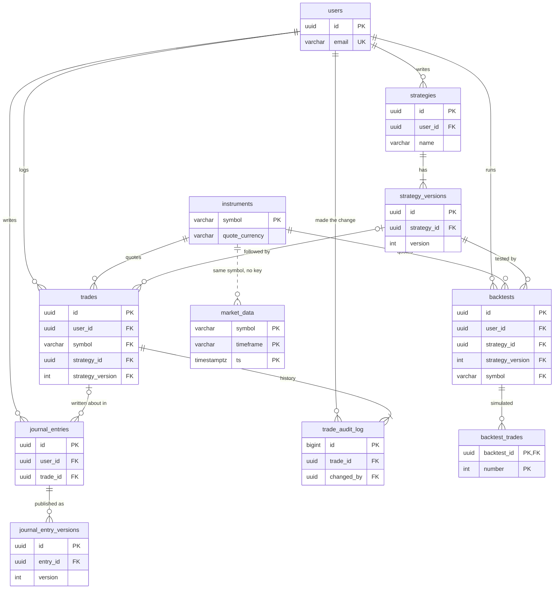

# The data model

Everything the app knows is kept in one PostgreSQL 16 database with the
[TimescaleDB](https://docs.timescale.com/) extension. This page describes its tables as the
migrations in [`backend/alembic/versions`](../backend/alembic/versions) build them. A test
compares every table's columns here with a freshly migrated database, so the page stays true.

To look for yourself, `make db-shell` opens `psql` on the database. There, `\d+ trades`
describes a table, with its columns in the same order as below.

## How the tables fit together



In words:

- **Your records.** An account owns its trades, strategies, backtests and journal entries.
- **Shared tables.** Instruments and market data belong to no one: every account sees the
  same prices and currencies.
- **History.** A trade keeps every change in its audit log. A strategy's rules live in
  numbered versions, and a published journal entry keeps each edit as a version.
- **Links.** A trade can name the strategy version it followed, and a journal entry the trade
  it is about. A backtest always names the strategy version it ran.

## Conventions

- **Names.** Keys and rules are named by pattern: `pk_<table>`,
  `fk_<table>_<column>_<other table>`, `uq_<table>_<column>`, `ck_<table>_<rule>` and
  `ix_<table>_<columns>`. When the database refuses a change, its error names the rule.
- **IDs** are UUIDs the database makes with `gen_random_uuid()`. The exceptions are
  instruments and bars, keyed by what they are; simulated trades, numbered within their
  backtest; and the audit log, numbered in order.
- **Times** are `timestamptz`: stored in UTC, and shown in your time zone by the app.
  - Most `created_at` columns default to `now()`, the time the transaction started.
  - Tables where order matters use `clock_timestamp()`, the time of the insert itself, so
    rows written in one transaction keep their order.
- **Money.** Prices, sizes, fees and P&L are `numeric(28,12)`: exact decimals with 12
  places, enough for a coin priced at 0.000012345678. Volume is `numeric(28,8)`.
- **Choices,** such as a trade's direction, are `varchar` with a CHECK rule listing the
  allowed values. A migration adds a value by replacing the rule.
- **Types** are written short below: `varchar` is `character varying`, and `timestamptz` is
  `timestamp with time zone`. Defaults leave out their casts: `'open'` is
  `'open'::character varying`.

## What can't be changed or deleted

- **Append-only tables.** `trade_audit_log`, `strategy_versions` and
  `journal_entry_versions` refuse `UPDATE`, `DELETE` and `TRUNCATE`. Triggers run a function
  that raises a `restrict_violation` error: `trade_audit_log_append_only()` for the audit
  log, and `append_only()` for the two version tables.

  ```text
  ERROR:  strategy_versions is append-only: UPDATE is not allowed
  ```

- **History holds on.** The keys that point at history use `ON DELETE RESTRICT`. So a trade
  with an audit log, a strategy with versions, a version a trade or backtest used, a trade a
  journal entry is about, and a journal entry with versions can't be deleted.
- **Accounts.** Deleting a user cascades to their trades, strategies, backtests and journal
  entries, but stops at the first one with a history. So an account that has been used can't
  be deleted.
- **Backtests can go.** Deleting a backtest deletes its simulated trades, and nothing else
  depends on it. The app has no button for it; in `make db-shell`,
  `DELETE FROM backtests WHERE …` removes old runs.

## The tables

### `users`

One row per account. The app is for one person: `make user` creates the account, and
`POST /api/auth/register` works only while this table is empty.

| Column | Type | Nullable | Default | Holds |
|---|---|---|---|---|
| `id` | `uuid` | not null | `gen_random_uuid()` | |
| `email` | `varchar(255)` | not null | | The login. Unique (`uq_users_email`) |
| `password_hash` | `varchar(255)` | not null | | The password's Argon2 hash. The password itself isn't kept |
| `is_active` | `boolean` | not null | `true` | False stops the account from logging in, and its tokens from working |
| `created_at` | `timestamptz` | not null | `now()` | |
| `updated_at` | `timestamptz` | not null | `now()` | Set by the app on each change |

### `instruments`

One row per symbol, with the currency its prices, fees and P&L are in. A symbol is
registered with a guessed currency the first time a trade, an import or a backtest uses it,
and that never changes a currency already there. See
[Instruments and currencies](guide.md#instruments-and-currencies).

| Column | Type | Nullable | Default | Holds |
|---|---|---|---|---|
| `symbol` | `varchar(20)` | not null | | As written on trades, bars and backtests: `BTCUSDT`, `BTC/USDT` |
| `quote_currency` | `varchar(10)` | | | 2 to 10 capital letters or digits (`ck_instruments_quote_currency_format`). Empty until set when the name doesn't tell, as with `AAPL` |
| `created_at` | `timestamptz` | not null | `now()` | |
| `updated_at` | `timestamptz` | not null | `now()` | |

Trades and backtests point here by `symbol` (`ON DELETE RESTRICT`).

### `market_data`

One price bar: open, high, low, close and volume over one timeframe. Bars of every size are
stored side by side; the app builds bigger ones from them when asked
([Stored bars, and bigger bars on demand](guide.md#stored-bars-and-bigger-bars-on-demand)).

| Column | Type | Nullable | Default | Holds |
|---|---|---|---|---|
| `symbol` | `varchar(20)` | not null | | |
| `timeframe` | `varchar(3)` | not null | | `1m`, `5m`, `15m`, `30m`, `1h`, `4h` or `1d` (`ck_market_data_timeframe`) |
| `ts` | `timestamptz` | not null | | When the bar starts |
| `open` | `numeric(28,12)` | not null | | |
| `high` | `numeric(28,12)` | not null | | |
| `low` | `numeric(28,12)` | not null | | |
| `close` | `numeric(28,12)` | not null | | |
| `volume` | `numeric(28,8)` | not null | | |
| `source` | `varchar(50)` | not null | | The file format it came from: `generic_ohlcv` or `binance_klines` |
| `imported_at` | `timestamptz` | not null | `now()` | |

- **Key:** `(symbol, timeframe, ts)`, so a bar is stored once. Importing it again counts it
  as a duplicate and keeps the first.
- **Rules:**
  - Prices are positive (`ck_market_data_prices_positive`), and volume isn't negative
    (`ck_market_data_volume_non_negative`).
  - The low is at or under the open and close, and the high at or over them
    (`ck_market_data_ohlc_consistent`).
  - The import also checks that each bar starts on its timeframe's boundary.
- **No key to `instruments`:** an import registers its symbol there itself.
- **A hypertable,** below: [Market data in TimescaleDB](#market-data-in-timescaledb).

### `trades`

A trade you logged: one entry, and once closed, one exit. See [Trades](guide.md#trades).

| Column | Type | Nullable | Default | Holds |
|---|---|---|---|---|
| `id` | `uuid` | not null | `gen_random_uuid()` | |
| `user_id` | `uuid` | not null | | Whose trade it is (`ON DELETE CASCADE`) |
| `strategy_id` | `uuid` | | | The strategy it followed, if any |
| `symbol` | `varchar(20)` | not null | | A registered instrument |
| `direction` | `varchar(5)` | not null | | `long` or `short` |
| `status` | `varchar(9)` | not null | `'open'` | `open`, `closed` or `cancelled` |
| `entry_price` | `numeric(28,12)` | not null | | Positive |
| `entry_time` | `timestamptz` | not null | | |
| `entry_size` | `numeric(28,12)` | not null | | Positive: units of the symbol bought or sold short |
| `entry_fee` | `numeric(28,12)` | not null | `0` | Not negative, in the quote currency |
| `exit_price` | `numeric(28,12)` | | | Positive. Set when closed |
| `exit_time` | `timestamptz` | | | Not before the entry. Set when closed |
| `exit_size` | `numeric(28,12)` | | | Above 0 and at most the entry size. Empty means the whole position |
| `exit_fee` | `numeric(28,12)` | not null | `0` | Not negative |
| `stop_loss` | `numeric(28,12)` | | | The stop you planned, for the record. Positive |
| `take_profit` | `numeric(28,12)` | | | The target you planned, for the record. Positive |
| `leverage` | `numeric(10,2)` | not null | `1` | At least 1 |
| `pnl` | `numeric(28,12)` | | | Profit or loss on the exited size, net of both fees. Set when closed |
| `pnl_pct` | `numeric(12,4)` | | | `pnl` as a percentage of the margin put in: entry price × exited size ÷ leverage |
| `created_at` | `timestamptz` | not null | `now()` | |
| `updated_at` | `timestamptz` | not null | `now()` | |
| `strategy_version` | `integer` | | | The version of the strategy it followed |

- **Rules:**
  - `ck_trades_exit_fields_only_when_closed`: an open or cancelled trade has no exit price,
    time or size, and no P&L.
  - `ck_trades_closed_trade_has_exit`: a closed trade has an exit price and time, and its
    P&L.
  - `ck_trades_strategy_version_with_strategy`: the strategy and its version are set
    together, or not at all.
  - One rule for each limit in the table above, such as `ck_trades_exit_size_in_range` and
    `ck_trades_exit_not_before_entry`, plus `ck_trades_direction` and `ck_trades_status`.
- **Keys:** `(strategy_id, strategy_version)` must be a version in `strategy_versions`, and
  `strategy_id` a strategy. Both use `ON DELETE RESTRICT`, as does `symbol`'s key to
  `instruments`.
- **Index:** `ix_trades_user_id_entry_time` serves the trades list, latest entry first.

### `trade_audit_log`

Every change to a trade, in order: logging it, editing it while open, closing, cancelling
and correcting. Append-only. See [A trade's history](guide.md#a-trades-history).

| Column | Type | Nullable | Default | Holds |
|---|---|---|---|---|
| `id` | `bigint` | not null | generated always as identity | A number that grows with each event, so events keep their order |
| `trade_id` | `uuid` | not null | | Indexed (`ix_trade_audit_log_trade_id`) |
| `event_type` | `varchar(10)` | not null | | `entry`, `update`, `exit`, `cancel` or `correction` |
| `old_values` | `jsonb` | | | The changed fields before the change. Empty for `entry` |
| `new_values` | `jsonb` | | | The changed fields after it. For `entry`, the trade as logged |
| `changed_by` | `uuid` | not null | | The user who made the change |
| `change_reason` | `varchar(500)` | | | The reason given: required for a correction, optional for a cancel |
| `created_at` | `timestamptz` | not null | `clock_timestamp()` | |

### `strategies`

A named strategy. Its rules aren't here: they are in `strategy_versions`, and
`current_version` says which one is in force. See [Strategies](guide.md#strategies).

| Column | Type | Nullable | Default | Holds |
|---|---|---|---|---|
| `id` | `uuid` | not null | `gen_random_uuid()` | |
| `user_id` | `uuid` | not null | | Whose strategy it is (`ON DELETE CASCADE`) |
| `name` | `varchar(100)` | not null | | Unique among the user's strategies (`uq_strategies_user_id`) |
| `description` | `text` | | | |
| `current_version` | `integer` | not null | `1` | |
| `created_at` | `timestamptz` | not null | `now()` | |
| `updated_at` | `timestamptz` | not null | `now()` | Changed by a new version, or a new name or description |

### `strategy_versions`

One saved set of rules. Append-only, so a backtest that names a version can always be run
again on the same rules.

| Column | Type | Nullable | Default | Holds |
|---|---|---|---|---|
| `id` | `uuid` | not null | `gen_random_uuid()` | |
| `strategy_id` | `uuid` | not null | | |
| `version` | `integer` | not null | | 1, 2, 3… Unique within the strategy (`uq_strategy_versions_strategy_id`) |
| `definition` | `jsonb` | not null | | The rules, as described in [the rule language](rules.md), checked before saving |
| `changed_fields` | `varchar(50)[]` | | | The rules' top-level parts that differ from the version before, such as `{take_profit_r}`. Empty for version 1 |
| `created_at` | `timestamptz` | not null | `clock_timestamp()` | |

### `backtests`

One run of a strategy version over one symbol's bars. Its settings are fixed when it is
created; the run fills in the rest. See [Backtests](guide.md#backtests).

| Column | Type | Nullable | Default | Holds |
|---|---|---|---|---|
| `id` | `uuid` | not null | `gen_random_uuid()` | |
| `user_id` | `uuid` | not null | | Whose run it is (`ON DELETE CASCADE`) |
| `strategy_id` | `uuid` | not null | | With `strategy_version`, the exact rules it ran |
| `strategy_version` | `integer` | not null | | |
| `symbol` | `varchar(20)` | not null | | A registered instrument |
| `timeframe` | `varchar(3)` | not null | | The bars it ran on, `1m` to `1d` |
| `start_ts` | `timestamptz` | | | The first bar asked for. Empty means from the first stored bar |
| `end_ts` | `timestamptz` | | | Bars starting before this. Empty means to the last stored bar |
| `initial_capital` | `numeric(28,12)` | not null | | Positive, in the quote currency |
| `position_size_pct` | `numeric(8,4)` | not null | | Above 0 and at most 1,000: over 100 borrows the rest |
| `fee_pct` | `numeric(7,4)` | not null | | 0 to 10, charged on each fill |
| `slippage_pct` | `numeric(7,4)` | not null | | 0 to 10, against you on market and stop fills |
| `periods_per_year` | `integer` | not null | | 1 to 366: 365 for crypto, 252 for stock exchanges |
| `status` | `varchar(9)` | not null | `'pending'` | `pending`, `running`, `completed` or `failed` |
| `error_message` | `text` | | | Why it failed. Required when it did |
| `bars_count` | `integer` | | | How many bars it read |
| `first_bar_ts` | `timestamptz` | | | The first bar it read |
| `last_bar_ts` | `timestamptz` | | | The last bar it read |
| `data_hash` | `varchar(64)` | | | The data fingerprint: a SHA-256 of every bar it read, finer bars included |
| `metrics` | `jsonb` | | | The results, as `GET /api/backtests/{id}` returns them. Required when completed |
| `equity_curve` | `jsonb` | | | Points `{ts, equity, benchmark}` for the chart, thinned out but keeping each stretch's low and high. Required when completed |
| `created_at` | `timestamptz` | not null | `clock_timestamp()` | |
| `started_at` | `timestamptz` | | | |
| `completed_at` | `timestamptz` | | | When it completed or failed |
| `detail_timeframe` | `varchar(3)` | | | The finer bars that settled fills inside a bar. Empty means none |
| `out_of_sample_from` | `timestamptz` | | | Where the out-of-sample part starts. Inside the asked-for range (`ck_backtests_out_of_sample_inside_range`) |
| `split_metrics` | `jsonb` | | | With a split: `{"in_sample": …, "out_of_sample": …}`, each side's results |

- **Rules:** one for each limit above, such as `ck_backtests_position_size_in_range`. Also
  `ck_backtests_range_not_empty`: the start comes before the end.
- **Keys:** `(strategy_id, strategy_version)` must be a version in `strategy_versions`, and
  `symbol` an instrument. Both use `ON DELETE RESTRICT`.
- **Index:** `ix_backtests_user_id_created_at` serves the backtests list, newest first.
- **Restarts:** runs work in the API's process. When it starts, runs left `pending` or
  `running` by a restart are marked `failed`.

### `backtest_trades`

One simulated round trip, numbered in the order the backtest made them. Its money is in the
backtest's quote currency.

| Column | Type | Nullable | Default | Holds |
|---|---|---|---|---|
| `backtest_id` | `uuid` | not null | | `ON DELETE CASCADE`: the trades go with their backtest |
| `number` | `integer` | not null | | 1, 2, 3… The key is `(backtest_id, number)` |
| `direction` | `varchar(5)` | not null | | `long` or `short` |
| `entry_time` | `timestamptz` | not null | | The start of the bar it filled in |
| `entry_price` | `numeric(28,12)` | not null | | The fill, after slippage |
| `exit_time` | `timestamptz` | not null | | Not before the entry |
| `exit_price` | `numeric(28,12)` | not null | | The fill, after slippage |
| `size` | `numeric(28,12)` | not null | | Units of the symbol |
| `entry_fee` | `numeric(28,12)` | not null | | |
| `exit_fee` | `numeric(28,12)` | not null | | |
| `slippage` | `numeric(28,12)` | not null | | What slippage cost on both fills, in money |
| `pnl` | `numeric(28,12)` | not null | | Net of both fees |
| `pnl_pct` | `numeric(12,4)` | not null | | `pnl` as a percentage of the entry's value (price × size) |
| `exit_reason` | `varchar(13)` | not null | | `signal`, `stop_loss`, `take_profit`, `trailing_stop`, `time_exit`, `end_of_day`, `margin_call` or `end_of_data` |

### `journal_entries`

A journal entry, optionally about one of your trades. A draft changes in place; once
published, each edit is kept in `journal_entry_versions`. See [Journal](guide.md#journal).

| Column | Type | Nullable | Default | Holds |
|---|---|---|---|---|
| `id` | `uuid` | not null | `gen_random_uuid()` | |
| `user_id` | `uuid` | not null | | Whose entry it is (`ON DELETE CASCADE`) |
| `trade_id` | `uuid` | | | The trade it is about (`ON DELETE RESTRICT`) |
| `entry_type` | `varchar(10)` | not null | | `pre_trade`, `post_trade` or `note` |
| `title` | `varchar(200)` | not null | | |
| `thesis` | `text` | | | |
| `market_context` | `text` | | | |
| `risk_assessment` | `text` | | | |
| `lessons` | `text` | | | |
| `emotion` | `varchar(10)` | | | `calm`, `confident`, `excited`, `greedy`, `fomo`, `fearful`, `frustrated`, `impatient` or `uncertain` |
| `tags` | `varchar(50)[]` | not null | `'{}'` | Lowercase words, at most 20, checked by the app |
| `status` | `varchar(9)` | not null | `'draft'` | `draft` or `published` |
| `current_version` | `integer` | not null | `0` | 0 for a draft, then the latest version |
| `published_at` | `timestamptz` | | | Set exactly when published (`ck_journal_entries_published_at_when_published`) |
| `created_at` | `timestamptz` | not null | `clock_timestamp()` | |
| `updated_at` | `timestamptz` | not null | `now()` | |

- **Rules:** a published entry has version 1 or later, and a draft version 0
  (`ck_journal_entries_versions_when_published`).
- **Index:** `ix_journal_entries_user_id_created_at` serves the journal list, newest first.

### `journal_entry_versions`

A published state of an entry: version 1 is the publication, and each later one an edit.
Append-only, so what you first wrote can always be read again.

| Column | Type | Nullable | Default | Holds |
|---|---|---|---|---|
| `id` | `uuid` | not null | `gen_random_uuid()` | |
| `entry_id` | `uuid` | not null | | |
| `version` | `integer` | not null | | 1, 2, 3… Unique within the entry (`uq_journal_entry_versions_entry_id`) |
| `content` | `jsonb` | not null | | The entry at that version: its type, trade, title, the four texts, emotion and tags |
| `changed_fields` | `varchar(50)[]` | | | The fields that differ from the version before. Empty for version 1 |
| `edit_reason` | `varchar(500)` | | | Why it was edited. Empty exactly for version 1 (`ck_journal_entry_versions_edits_have_a_reason`) |
| `created_at` | `timestamptz` | not null | `clock_timestamp()` | |

### `alembic_version`

Alembic's own table: one row holding the latest migration applied.

| Column | Type | Nullable | Default | Holds |
|---|---|---|---|---|
| `version_num` | `varchar(32)` | not null | | The revision, such as `fe71d3af3451` |

## Market data in TimescaleDB

`market_data` is a TimescaleDB hypertable. It reads and writes like a table, while
TimescaleDB keeps it in pieces:

- **Chunks.** It is split by `ts` into chunks of 30 days each.
- **Compression.** Chunks whose bars all started more than 30 days ago are compressed into
  columns, grouped by symbol and timeframe and sorted by time. A background job looks for
  them every 12 hours. Compressed bars are read, and imported into, like any others.
- **Indexes.** The primary key's index serves lookups by symbol, timeframe and time range,
  so TimescaleDB's own index on `ts` isn't made.

To see them in `make db-shell`:

```sql
SELECT * FROM timescaledb_information.hypertables;
SELECT * FROM timescaledb_information.compression_settings;
SELECT job_id, schedule_interval, config FROM timescaledb_information.jobs
WHERE hypertable_name = 'market_data';
SELECT chunk_name, range_start, range_end, is_compressed FROM timescaledb_information.chunks;
```

## The migrations

The migrations build all of the above, in this order. `make migrate` applies any that are
missing, and so does the API's container each time it starts.

| Revision | Date | What it does |
|---|---|---|
| `25eec0b13704` | 2026-10-13 | Creates `users` |
| `95e6ad5d9740` | 2026-10-13 | Creates `trades` |
| `2cfdf1878853` | 2026-10-13 | Creates `trade_audit_log`, with its append-only triggers |
| `2af3f1c8f54f` | 2026-10-13 | Adds the `correction` audit event |
| `4d1d1fedb94b` | 2026-10-13 | Creates `market_data` as a hypertable |
| `e8fb1ee5e765` | 2026-10-13 | Compresses market data older than 30 days |
| `b23f1b9c0b78` | 2026-10-13 | Widens prices, sizes, fees and P&L to 12 decimal places |
| `fb2ebc0d96b2` | 2026-10-13 | Creates `strategies` and `strategy_versions`, with `append_only()`, and links trades to strategies |
| `48c51447ee82` | 2026-10-13 | Creates `backtests` and `backtest_trades` |
| `1a12daf7045f` | 2026-10-13 | Creates `journal_entries` and `journal_entry_versions` |
| `5bbf6863d795` | 2026-10-14 | Records the strategy version a trade followed |
| `0650b782e329` | 2026-10-14 | Creates `instruments`, registering the symbols already in use |
| `0eb35eac0f73` | 2026-10-14 | Links trades and backtests to `instruments` |
| `21520878d22b` | 2026-10-15 | Adds the `trailing_stop` and `time_exit` exit reasons |
| `8d8eb2e16128` | 2026-10-15 | Adds `detail_timeframe` to backtests |
| `d7b921158f73` | 2026-10-15 | Adds the out-of-sample split to backtests |
| `c956f8721a3e` | 2026-10-16 | Adds the `end_of_day` and `margin_call` exit reasons |
| `fe71d3af3451` | 2026-10-16 | Allows positions up to 1,000% of equity |
